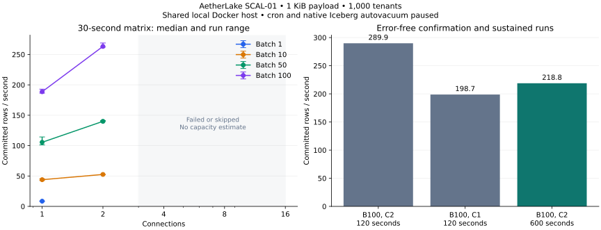

# SCAL-01: measured write-path scalability

Measured on 8 November 2026. These results characterize one local Docker deployment; they are not a production SLO.

**218.82 committed rows/sec over 601.85 seconds** with 2 connection(s), batch 100, approximately 1 KiB payloads and 1,000 tenant IDs. The run acknowledged 131,700 rows in 1,317 INSERT transactions, with no errors and exact row/snapshot reconciliation.

A throughput plateau was not established. Failed concurrency levels are a failure boundary, not a capacity estimate.

## Thirty-second matrix

Each accepted cell contains three error-free repetitions on fresh volumes. Rates are the median and minimum–maximum run range. Latency is the median of the three per-run p95 values, not a pooled percentile. Partial successful repetitions do not qualify a cell.

| Batch | Connections | Result | Rows/sec, median [range] | INSERT p95, median ms |
|---:|---:|---|---:|---:|
| 1 | 1 | 3/3 passed | 8.57 [8.55–8.72] | 206.37 |
| 1 | 2 | 0/1 passed; cell failed | — | — |
| 1 | 4 | Skipped after lower-concurrency failure | — | — |
| 1 | 8 | Skipped after lower-concurrency failure | — | — |
| 1 | 16 | Skipped after lower-concurrency failure | — | — |
| 10 | 1 | 3/3 passed | 43.95 [42.59–45.46] | 371.54 |
| 10 | 2 | 3/3 passed | 52.58 [52.06–52.59] | 691.71 |
| 10 | 4 | 0/1 passed; cell failed | — | — |
| 10 | 8 | Skipped after lower-concurrency failure | — | — |
| 10 | 16 | Skipped after lower-concurrency failure | — | — |
| 50 | 1 | 3/3 passed | 105.50 [101.13–114.28] | 693.63 |
| 50 | 2 | 3/3 passed | 139.97 [139.87–141.20] | 1310.92 |
| 50 | 4 | 0/1 passed; cell failed | — | — |
| 50 | 8 | Skipped after lower-concurrency failure | — | — |
| 50 | 16 | Skipped after lower-concurrency failure | — | — |
| 100 | 1 | 3/3 passed | 188.67 [186.40–192.95] | 769.27 |
| 100 | 2 | 3/3 passed | 263.27 [262.26–268.90] | 1513.69 |
| 100 | 4 | 0/1 passed; cell failed | — | — |
| 100 | 8 | Skipped after lower-concurrency failure | — | — |
| 100 | 16 | Skipped after lower-concurrency failure | — | — |

## Confirmation and sustained trials

Rates for failed trials are diagnostic only. All latency percentiles describe successful INSERT transactions; they exclude failed statements and client batch-fill waiting.

| Trial | Batch / connections | Requested / elapsed s | Rows/sec | p50 / p95 / p99 ms | Outcome |
|---|---:|---:|---:|---:|---|
| confirm-b100-c2 | 100 / 2 | 120 / 120.37 | 289.94 | 548.82 / 1729.58 / 1951.47 | Passed |
| confirm-b100-c1 | 100 / 1 | 120 / 120.76 | 198.75 | 446.28 / 877.44 / 1094.00 | Passed |
| sustained | 100 / 2 | 600 / 601.85 | 218.82 | 879.17 / 1509.75 / 1893.27 | Passed |

The accepted sustained run used a 600.000-second load window plus 1.853 seconds of in-flight drain. Rows increased from 12 to 131,712; retained snapshots increased from 14 to 1,331. The 1,317-snapshot delta equals its successful transaction count (2.188/sec). This equivalence holds for this verified, maintenance-paused experiment only.

Bucket growth was 754.17 MiB across 44,006 objects. This includes data and metadata objects; it is not compressed row size or retained-history steady state.

## Failure evidence

| Point | SQLSTATE failures | Snapshot reconciliation |
|---|---|---|
| b1-c2-r1 | `{"statement:40P01": 1}` | True |
| b10-c4-r1 | `{"statement:40P01": 1, "statement:53400": 1}` | True |
| b50-c4-r1 | `{"statement:40P01": 1, "statement:53400": 1}` | True |
| b100-c4-r1 | `{"statement:40P01": 1, "statement:53400": 1}` | True |

PostgreSQL logs identify `40P01` as deadlock detection and `53400` as background-worker-slot exhaustion. Deadlock context includes the `FOR UPDATE` lock on `lake_iceberg.tables_internal`. These are distinct failure modes: raising the worker limit alone does not establish that metadata contention is resolved. The experiment preserves the default worker budget and applies no server performance tuning.

## Environment and protocol

- Source: [`3115d87`](https://github.com/Senthilsivam41/innovation-pglake/commit/3115d87a2bdfe9f76f84b1007a1a28d9286c4e36); clean at launch: `True`. Run ID: `20261108T111021Z-4ff0d777`.
- Docker 29.9.2, aarch64, 14 vCPU, 7.748 GiB assigned memory; 23 other containers running at launch. This is a shared host, below the README's 16 GB recommendation.
- Python 3.12.13, asyncpg 0.32.0, PostgreSQL 18.1; exact extension versions, image IDs, settings and schema/partition contract are recorded in the evidence JSON.
- `max_worker_processes=8`, `max_parallel_workers=8`, `max_connections=100`, `shared_buffers=128 MiB`, `work_mem=4 MiB`.
- One fresh Compose stack per repetition; two seed rows, then ten single-row warmup transactions; random seed 0. The canonical events table retains its outbox trigger and day/bucket(32, tenant_id) partitioning.
- Cron and native Iceberg autovacuum paused and verified only on disposable benchmark tables. The existing demo and other containers were not stopped or changed.
- Minimum sampled MinIO filesystem free space: 387.69 GiB. The reserve is the greater of 20 GiB or 20% of filesystem size, checked before load and throughout each run.
- Throughput includes payload generation and bounded drain; it excludes connection startup, warmup and post-run reconciliation. Resource samples use a five-second pause plus Docker/SQL collection overhead and can miss short contention episodes.

## Preliminary cohort retained

The earlier 7–8 November cohort paused cron but left native Iceberg autovacuum enabled. Its two-writer, batch-100 sustained trial failed with `40P01` after 598.30 seconds and 97,600 acknowledged rows. Its one-writer trial completed 600.81 seconds with 83,200 acknowledged rows and no insert errors (138.48 rows/sec), but the snapshot delta was 835 for 832 successful transactions. It remains invalid under the declared snapshot gate and is excluded from the corrected matrix and headline.

The pinned upstream source documents an independent ten-minute Iceberg autovacuum timer ([pg_lake documentation](https://github.com/Snowflake-Labs/pg_lake/blob/01c529dedde75777e09298ae41786d9ae1f337cf/docs/iceberg-tables.md#autovacuum-on-iceberg-tables)). The mismatch and maintenance activity exposed the isolation gap; they do not prove that autovacuum caused every observed deadlock. The corrected experiment starts from fresh volumes, disables per-table native autovacuum, and records its options. It is a separate cohort, not a retry that replaces failed measurements. [Preliminary evidence](scalability-preliminary-evidence.json) preserves every completed point and source/resume provenance; the user-interrupted startup is excluded from measurements.

## Evidence and next experiments

- [Per-run CSV](scalability-results.csv): successful, failed and skipped points, timing, latency, counters and storage growth.
- [Measured evidence JSON](scalability-evidence.json): source/image/environment provenance, qualified cells, failures and sampled resource peaks.
- Local raw results: `.aetherlake/load-tests/20261108T111021Z-4ff0d777/`; the evidence JSON includes the raw manifest SHA-256. Raw resource samples and PostgreSQL failure log tails stay in that ignored directory.
- [Runbook](scalability-testing.md): reproduce the matrix and bounded, capacity-guarded runner.

Next, use a separate experiment to test native maintenance under load and the worker budget, then evaluate a serialized/batched writer or heap staging with periodic bulk movement if the application needs higher write concurrency. Any staging design must make its acknowledgement and analytical-visibility delay explicit. Repeat on dedicated hardware with production-sized data and an agreed throughput/latency target before making a production capacity claim. Independent Spark reads under write load, cloud object storage, long-term retention, and Databricks remain untested here.
